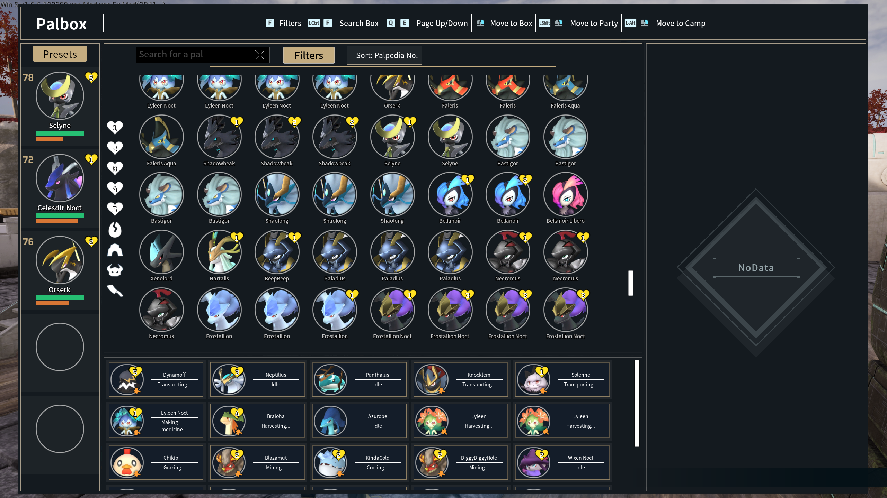
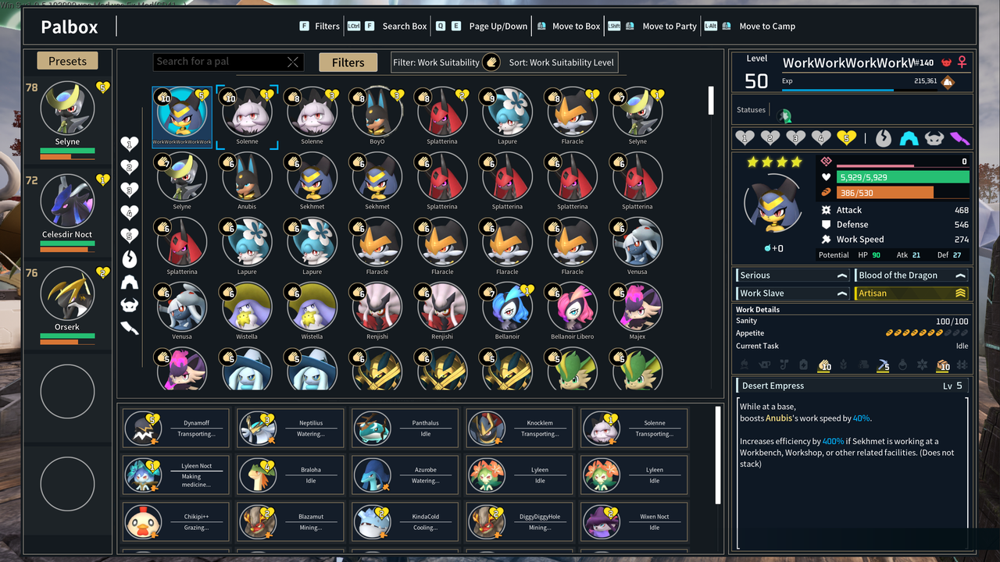
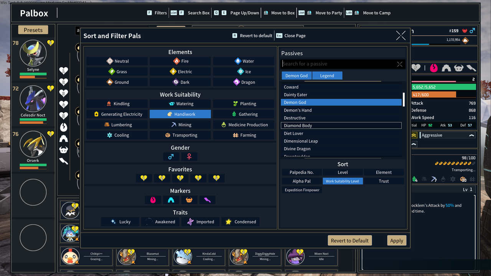

# PalboxUI

## Description

This is a complete overhaul of the palbox's UI. It's one file to install and remove, and it streamlines the palbox and handles some of its biggest pain points.

It is still a work in progress, so back up your saves before trying it out. I would also love to hear any feedback and any feature requests or bug reports.
This _should_ be completely fine to use on multiplayer worlds that allow mods, but I have not thoroughly tested that yet. If any issues are found please [report them](../../issues)!







## Features Added

* Key Palbox improvements
   * The palbox is now a single scrolling grid. No more paging through 30 pages to find one pal.
   * Adds a searchbox so pals can be searched for by name or by nickname
   * More visual clarity - names are visible so you no longer have to mouse over
     every pal to search for them
   * Favorites is expanded to 5, and additional markers for breeding, expeditions,
     raids, and butchering have been added to make it easier to sort and find the
     right pals
   * Your existing favorites carry over, and favs 1-3 stay synced with the game's
     own locks.
   * Filter page is updated with additional filters and a much easier to use
     passives search
   * Matching pals get moved to the front of the box, best matches first
   * When a filter or sort is applied, a context bubble appears to display
     relevant matches, and the toolbar shows which filter and sort are active
   * Hotkeys added to make moving through the palbox much quicker - F opens
     filters, Ctrl+F jumps to the searchbox, and in the filter page R resets and
     Esc closes
* Expeditions - keep pals off expeditions right from the palbox
   * Click a pal's expedition marker in the detail pane a second time to set it
     to never send
   * It's the game's own expedition exclusion, so the expedition screen and its
     auto assign skip them too, and pals you've already excluded show up as never
     send
* Improved detail pane
   * You can apply markers or favorites by clicking on the icons in the detail pane
   * Reorganized pane so important features are clustered together - stats, IVs, and passives in the center
* Moving pals
   * Right click to move pals to the palbox, shift right click to move to camp,
     alt right click to move to party
* Party presets now use the new detail pane

## Requirements

* The latest version of Palworld
* The single mod .pak file

## Installing

1. Download [`PalboxUI_P.pak`](../../releases/latest/download/PalboxUI_P.pak)
   from the latest release
2. Open your Palworld folder - in Steam, right click Palworld -> Manage -> Browse
   local files
3. Go to `Pal\Content\Paks\` and make a folder called `~mods` if there isn't one
4. Drop `PalboxUI_P.pak` in there, so you end up with:

   ```
   Palworld\Pal\Content\Paks\~mods\PalboxUI_P.pak
   ```

5. Start the game and open any palbox

To update, just replace the file with the new one.

## Uninstalling

Delete `Palworld\Pal\Content\Paks\~mods\PalboxUI_P.pak` and the game's own palbox
comes back next time you start the game.

Your pals, boxes and bases aren't touched. A couple things to know:

* Favs 1-3 are the game's own locks, so they stay as the normal lock icons
* Never send is the game's own expedition exclusion, so those pals stay excluded
* Favs 4-5 and the markers are saved in the mod's own file, so the normal palbox
  won't show them. They come back if you reinstall. If you want them gone for
  good, delete the matching `PalboxUI_<WorldID>.sav` in:

  ```
  %LOCALAPPDATA%\Pal\Saved\SaveGames\
  ```

## Good to know

* It's client side only - nothing needs to be installed on the server, and other
  players don't need the mod. Multiplayer is still being tested though
* Other mods that replace the palbox will conflict with this one
